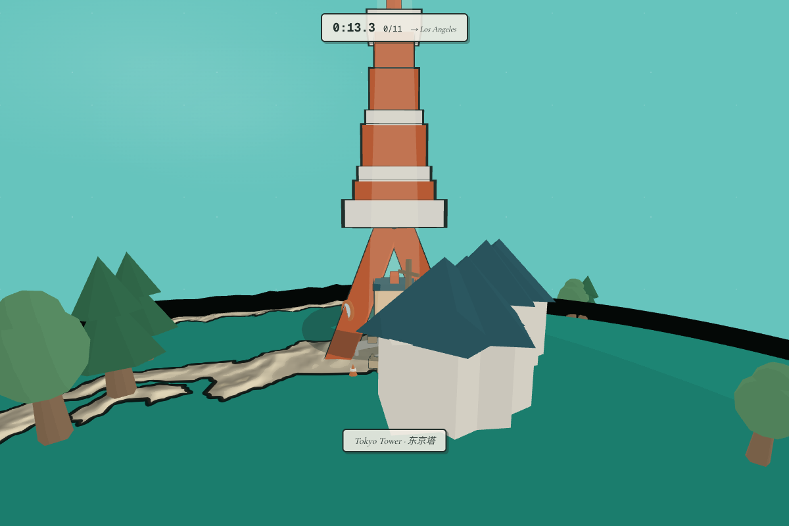

# Earth Run

Explore a tiny toon planet with a dog companion. Start beside Tokyo Tower,
follow a short pedestrian approach, take a postcard and collect a passport
stamp, then walk to the travel station to choose another city. City transfers
are immediate; the station represents a connection to a port or airport,
not a simulated scheduled ferry journey.



Sister piece to [Quake Globe](https://github.com/Jada-Q/quake-globe) —
the rendering engine (SDF land-mask toon planet, ink outlines, the whole
ambient life pack) was born there.

## Controls

- **WASD / arrows** or on-screen movement buttons: walk and turn.
- **Follow the dog**: assisted walking to the current photo point or travel station.
- **E / contextual action**: take a postcard and stamp, or select the next city when nearby.
- **Camera / controls**: turn and zoom the camera; **landmark overview** frames the building.
- **Space**: jump; hold to fly. The on-screen flight control is inside the controls panel.
- **Passport**: view locally saved stamps. Postcard images can be downloaded;
  images are not persisted automatically. Storage failure leaves an in-memory passport.
- Rendering controls are restricted to `?debug=1`. The original race implementation
  remains in the source, but exploration does not show a timer or activate its gates.

## Tokyo discovery and photography

Tokyo now has an optional side path. Near the fork, the dog sniffs and looks back;
players can investigate or continue to the landmark. A resident asks for a lost
camera pouch. Find it by the bench and return it to unlock a pink sakura scarf,
which the companion wears in every city. The reward persists locally. Paving follows the rendered ground normal so slopes
do not conceal the character's feet. Pausing
the task keeps the carried pouch for the current session; unfinished task progress
is not persisted across a reload.

At a landmark photo point, opening the camera does not stamp the passport.
Choose a landmark or traveler-and-dog framing preset, orbit, tilt and zoom, then
press the shutter. Canceling preserves the photo objective. Framing hints check
visible mesh bounds against the camera; they are advisory, not a score or an
occlusion detector. PNG postcards include a soft sky background and exclude HUD
controls. Downloading remains an explicit action.

## Journey validation

The Tokyo photo → stamp → departure → Paris transfer was checked in the browser.
All 11 approach corridors were sampled against building and local planting collision
circles. Pedestrian elevation now follows the same 256 × 192 triangulated surface
as the renderer; 33 city-route checks matched raycast heights within 7 mm.

## Tech

- Next.js 16 + three.js, no physics engine — the planet is an analytic
  unit sphere, so the runner is one quaternion and walking is rotating it
- Planet shader samples a baked 2048×1024 mask: R = land SDF (crisp
  coastlines at any zoom + free coastline ink), G = vegetation noise,
  B = city-light splats (`pnpm bake` regenerates from world-atlas)
- Regional houses and six tree species use instancing; detailed characters
  and landmarks retain their own articulated or material groups.
- Physical asset sizes use one meter-to-world conversion. See
  [scale references](lib/three/scale-reference.md) for dimensions and sources.
  Globe geography remains compressed for the travel map.
- Blender landmark generation scripts live in `scripts/modeling/`; runtime
  geometry uses the existing three.js path without an additional model loader.
  `?models=original` retains the historical procedural landmark comparison.

## Run

```bash
pnpm install
pnpm dev   # http://localhost:3014
```

Part of [Jada-Q](https://github.com/Jada-Q)'s ambient world series —
sister pieces: [Quake Globe](https://github.com/Jada-Q/quake-globe),
Tide Pixels, Sky Traffic, Bay Ships, Subway Pulse.

## Data credits

- Terrain heightmap: [three-globe](https://github.com/vasturiano/three-globe) (MIT) — SRTM-derived, NASA public domain
- Coastlines / land mask: [Natural Earth](https://www.naturalearthdata.com/) (public domain) via [world-atlas](https://www.npmjs.com/package/world-atlas) (ISC)

MIT (code).
